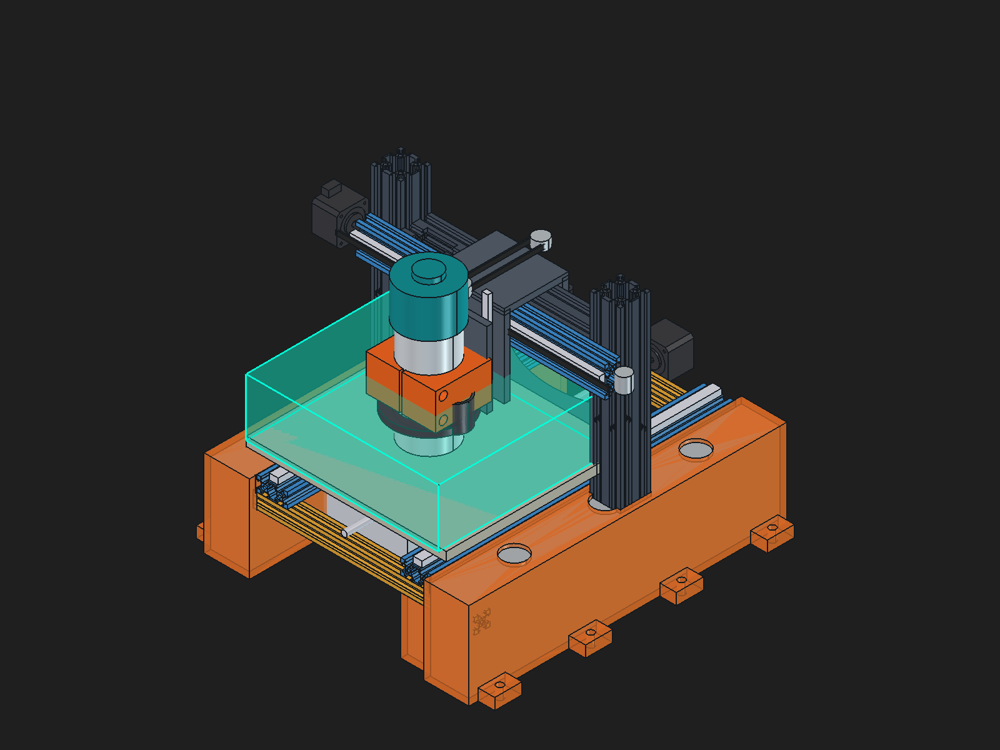
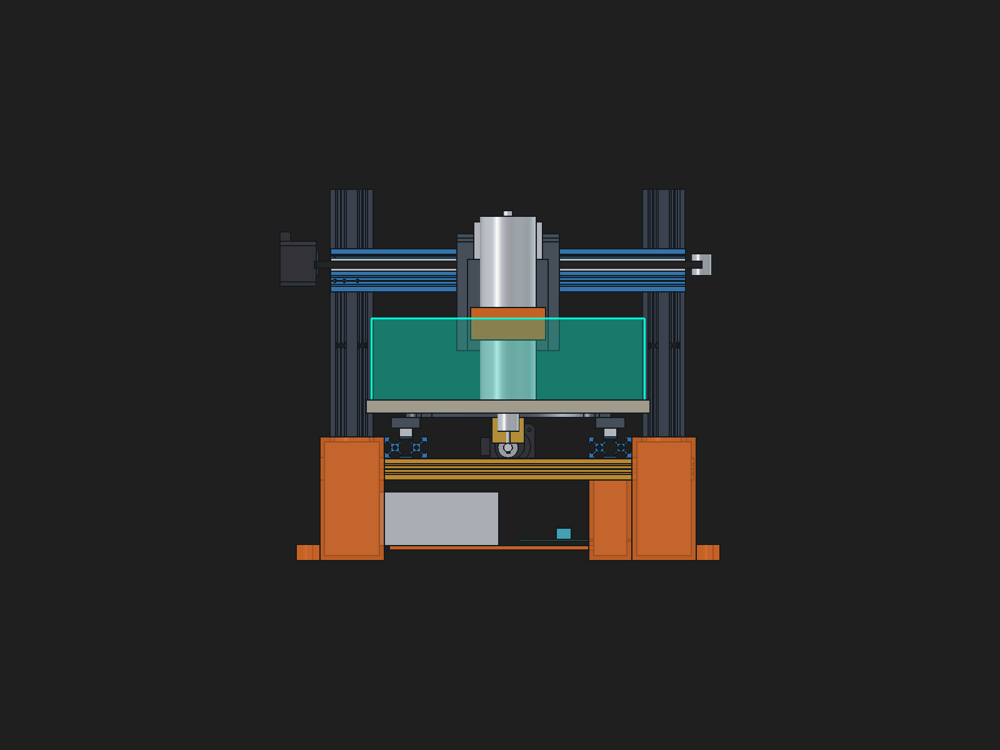
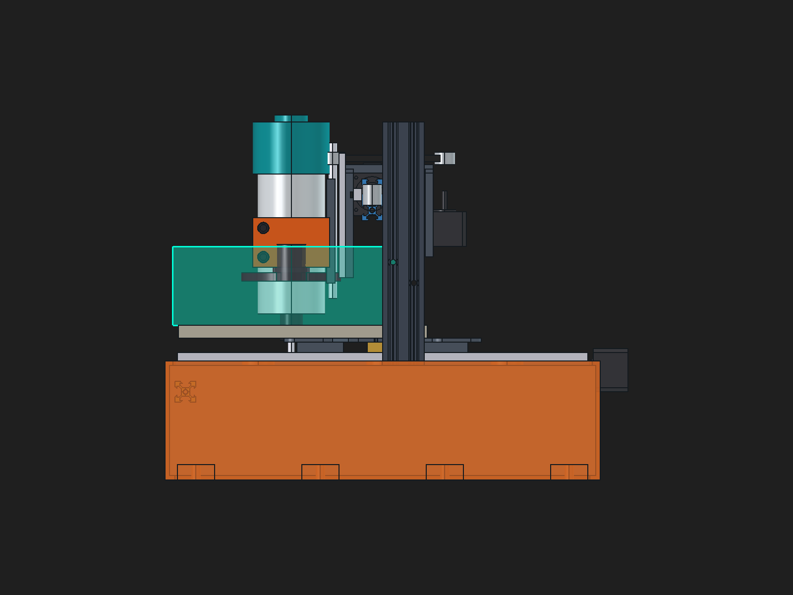
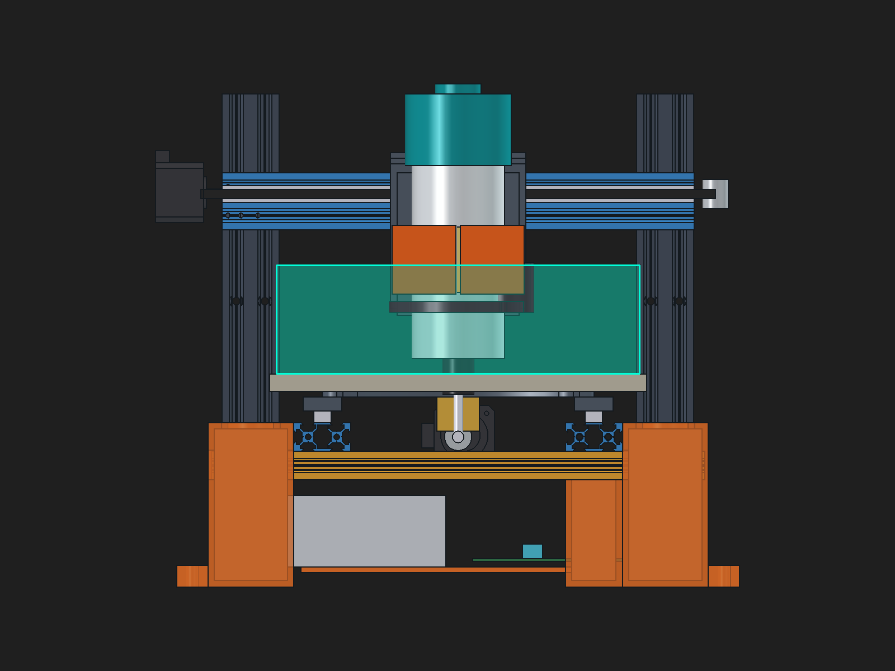
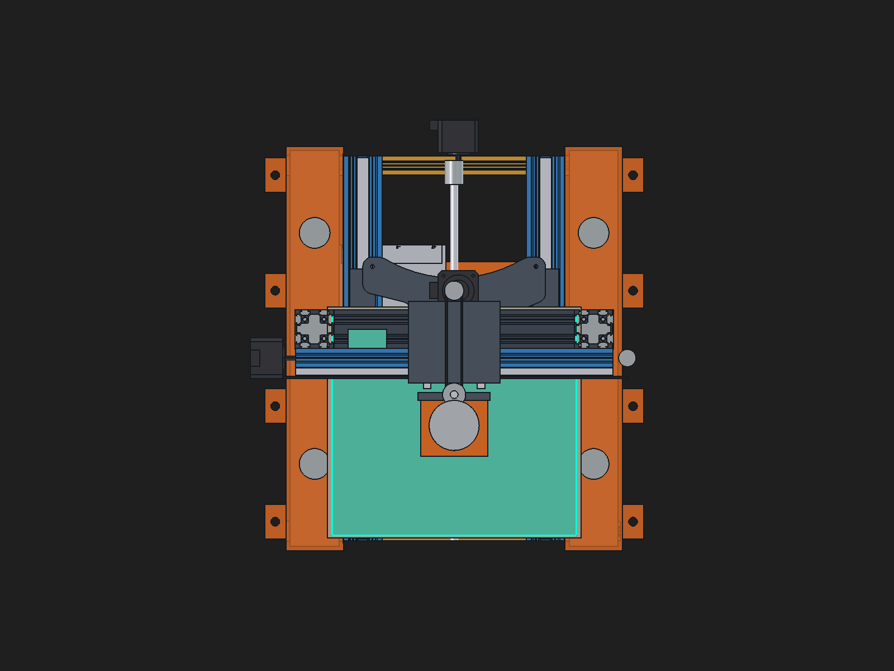
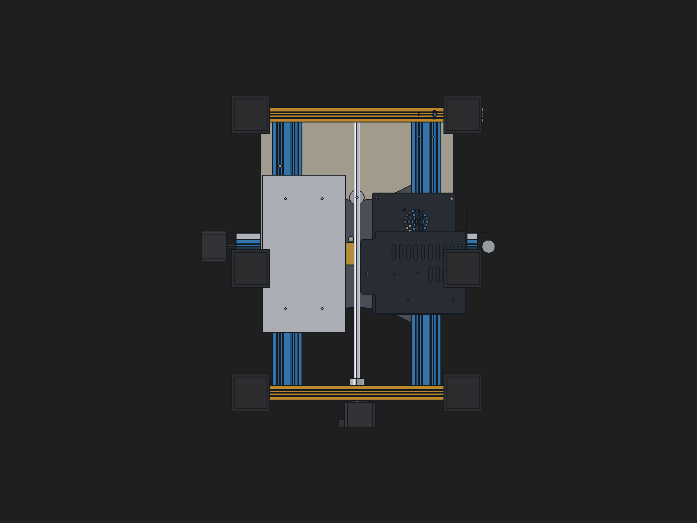

# Zero-Cut Creality Ender 3 $\to$ Desktop CNC Milling Machine

> **Zero Extrusion Cuts:** Re-engineers **100% of the 8 uncut factory aluminum extrusions** from the official Creality Ender 3 assembly into a rigid, vibration-damped fixed-bridge portal mill with a **$10.0" \times 9.0" \times 3.0"$ ($254.0 \times 228.6 \times 76.2\text{ mm}$)** cutting envelope.

---

## 1. Machine Highlights & Core Innovations

* **Working Cutting Envelope ($X \times Y \times Z$):** **$10.0" \times 9.0" \times 3.0"$** ($254.0 \times 228.6 \times 76.2\text{ mm}$) confirmed by 3D CAD collision and stroke verification.
* **Ground-Contacting Concrete Sills:** Twin $420\text{ mm}$ stay-in-place 3D-printed formwork shells touch the workbench directly at $Z = 0$, filled with $\sim 12.5\text{ kg}$ ($27.5\text{ lbs}$) of non-shrink precision grout to absorb milling vibrations.
* **Precision Extrusion Pockets:** Vertical $4040$ columns are embedded $60\text{ mm}$ deep into solid concrete column sockets; twin $2040$ Y-bed ways nest into stepped alignment shelves; and $2020$ ties lock in at square $90^\circ$ keyways.
* **Counterbalanced "Split-Weight" Router Head:** 
  * **Router in Front:** 65 mm Makita RT0701C (1.25 HP, 10,000–30,000 RPM) or 500W ER11 brushless DC spindle.
  * **Guidance in Middle:** Compound $60 \times 40\text{ mm}$ X-bridge (`4040 × 250 mm` + `2040 × 330 mm`) and MGN12H linear guide rail.
  * **Motor in Back:** Z-axis NEMA 17 stepper motor mounted behind the crossbar, driving the front T8 leadscrew via an overhead GT2 synchronous timing belt.
  * *Result:* Forward cantilever tipping moment on the linear bearings is reduced by $>60\%$, virtually eliminating tool chatter.
* **Heavy-Duty 65mm Split-Collar Clamp:** Extended $48\text{ mm}$ clamping face with tangential flex slit, dual $M6$ pinch bolts, captive nut pockets, magnetic snap-on dust boot interface, and a $65\text{ mm} \to 52\text{ mm}$ reduction sleeve.
* **Zero Sheet Metal / Protected Electronics Basement:** Eliminates the stock sheet metal boxes in favor of a 3D-printed slide tray suspended beneath the worktable between the concrete foundation beams, housing the 24V 15A PSU and 32-bit silent TMC controller board safe from falling chips.

---

## 2. Visual Showcase & CAD Renders

| Full Machine Assembly (Isometric) | Front Elevation & Ground Clearance |
| :---: | :---: |
|  |  |

| Counterbalanced Split-Weight Toolhead (Side View) | 65mm Router Clamp Close-Up (Front View) |
| :---: | :---: |
|  |  |

| Top View (Pour Funnels & Belt Transfer) | Undercarriage Electronics Slide Tray |
| :---: | :---: |
|  |  |

---

## 3. Extrusion Inventory & Zero-Cut Allocation

All 8 factory extrusions from Creality's official `01 MAIN ASM Ender_3.STEP` are preserved at their exact factory lengths:

| STEP Solid ID | Extrusion Profile | Factory Length | Stock Ender 3 Role | **CNC Milling Machine Role** |
| :--- | :--- | :--- | :--- | :--- |
| **`Solid[0]` & `Solid[1]`** | $4040$ Heavy V-Slot | $290.0\text{ mm}$ ($11.42"$) | Base Frame Legs | **Fixed Vertical Columns** (embedded $60\text{ mm}$ in concrete, $330\text{ mm}$ outer width) |
| **`Solid[2]`** | $4040$ Heavy V-Slot | $250.0\text{ mm}$ ($9.84"$) | Y-Bed Center Spine | **Inner X-Bridge Girder** (bolted between column inner faces at $X = \pm 125\text{ mm}$) |
| **`Solid[421]`** | $2040$ Medium V-Slot | $330.0\text{ mm}$ ($13.00"$) | Power Supply Strut | **Front X-Bridge Way** (spans full $330\text{ mm}$ width across front column faces) |
| **`Solid[4]` & `Solid[5]`** | $2040$ Medium V-Slot | $400.0\text{ mm}$ ($15.75"$) | Vertical Z-Uprights | **Twin Y-Axis Bed Rails** (spaced at $X = \pm 95\text{ mm}$ on concrete foundation shelves) |
| **`Solid[44]`** | $2020$ Light V-Slot | $345.0\text{ mm}$ ($13.58"$) | X-Axis Gantry Beam | **Front Base Cross-Tie** ($Y = -190\text{ mm}$, seated in foundation keyways) |
| **`Solid[3]`** | $2020$ Light V-Slot | $330.0\text{ mm}$ ($13.00"$) | Top Z-Frame Crossbar | **Rear Base Cross-Tie** ($Y = +190\text{ mm}$, seated in foundation keyways) |

---

## 4. Motion System Architecture

### A. Y-Axis (Moving Worktable)
* **Guidance:** Twin $400\text{ mm}$ MGN12H linear rails (or V-slot roller sets) mounted atop the twin `2040 × 400 mm` extrusions ($X = \pm 95\text{ mm}$).
* **Carriage:** Stock Ender 3 aluminum bed carriage plate ($190 \times 190\text{ mm}$) tied across both rails.
* **Drive:** Rear NEMA 17 stepper motor driving a central $370\text{ mm}$ T8 leadscrew through a flexible helical coupler into a brass anti-backlash nut block on the carriage underside.
* **Stroke:** **$9.0"$ ($228.6\text{ mm}$)** cutting stroke ($250\text{ mm}$ mechanical travel) with spoilboard table ($264 \times 240\text{ mm}$).

### B. X-Axis (Toolhead on Fixed Compound Bridge)
* **Guidance:** Compound $60 \times 40\text{ mm}$ bridge (`4040 × 250 mm` inner girder + `2040 × 330 mm` front beam) with front-mounted MGN12H linear guide rail.
* **Carriage:** Inverted "U" saddle plate ($95\text{ mm wide} \times 85\text{ mm deep} \times 8\text{ mm thick}$) straddling the bridge.
* **Drive:** Left-column NEMA 17 stepper driving a steel-core $6\text{ mm}$ GT2 timing belt with an adjustable right-column bearing tensioner.
* **Stroke:** **$10.0"$ ($254.0\text{ mm}$)** cutting stroke across the $330\text{ mm}$ span.

### C. Z-Axis (Vertical Plunge & Spindle Drive)
* **Guidance:** Twin vertical precision guide rails ($120\text{ mm}$) on the front of the saddle carriage.
* **Drive:** Rear-mounted NEMA 17 stepper motor driving the stock Ender 3 T8 stainless steel leadscrew via an overhead GT2 synchronous belt.
* **Stroke:** **$3.0"$ ($76.2\text{ mm}$)** vertical plunge depth with $15\text{ mm}$ retract clearance.

---

## 5. Counterbalanced Split-Weight Router Head

```
    [ FRONT: Cutting Zone ]            [ IN BETWEEN: Guidance ]            [ BACK: Counterbalance ]
   +-------------------------+      +-------------------------------+      +-----------------------+
   | Makita RT0701C Router   |      | Front MGN12 Linear Guide Rail |      | Z-Axis NEMA 17 Stepper|
   | 65mm Split Collar Clamp |<====>| 2040 x 330 mm Front Way Extr  |<====>| Rear Drop Bracket     |
   | Vertical Z-Plunge Slide |      | 4040 x 250 mm Inner Girder    |      | Top GT2 Drive Pulley  |
   | Front T8 Leadscrew      |      | (Combined X = 330 mm Bridge)  |      |                       |
   +-------------------------+      +-------------------------------+      +-----------------------+
       Mass: ~1.80 kg                        Support Plane                     Mass: ~0.55 kg
     Lever Arm: -88 mm                      Pivot: Y = 0 mm                 Lever Arm: +60 mm
```

* **Reduced Bearing Tilt:** Placing the stepper motor behind the crossbar and the cutting tool in front balances the carriage across the linear guide rails, preventing front-end droop and high-frequency tool chatter.
* **Dual Spindle Compatibility:** Accepts standard $65\text{ mm}$ trim routers (Makita RT0701C, Carbide 3D) and includes a precision $65\text{ mm} \to 52\text{ mm}$ split adapter sleeve for $500\text{ W}$ ER11 brushless DC spindles.
* **Snap-on Magnetic Dust Boot:** Four neodymium magnetic pockets on the clamp underside allow a vacuum dust sweep to pop on and off effortlessly.

---

## 6. Repository Organization

```text
enderCNC/
├── README.md                               # Project documentation & engineering specs
├── cad/
│   ├── Ender3_Router_Clamp_Mechanism.FCStd # Complete master assembly with 65mm Makita router & clamp
│   ├── Ender3_Concrete_Hybrid_CNC.FCStd    # Hybrid concrete foundation shells & extrusion seating
│   ├── Ender3_Option1_Counterbalanced_CNC.FCStd # Counterbalanced split-weight toolhead
│   ├── Ender3_Option1_Full_CNC.FCStd       # Baseline Option 1 motion assembly
│   └── Ender3_3_Extrusion_Layouts_Comparison.FCStd # 3-way layout comparison
├── scripts/
│   ├── design_router_clamp.py              # Parametric router clamp generator & renderer
│   ├── build_hybrid_concrete_cnc.py        # Concrete foundation shell generator & renderer
│   ├── update_counterbalanced_toolhead.py  # Saddle carriage & overhead belt generator
│   ├── build_option1_cnc.py                # Full Option 1 assembly script
│   └── compare_3_layouts.py                # 3-way layout generator & renderer
├── visuals/
│   └── renders/                            # High-resolution multi-view renders & close-ups
├── router_clamp_engineering_report.md      # Detailed 65mm router clamp research & specs
├── hybrid_concrete_foundation_guide.md     # Concrete formwork & ground-anchoring guide
├── counterbalanced_router_head.md          # Static moment calculations & toolhead details
├── ender3_option1_motion_plan.md           # X, Y, Z motion mechanism specifications
└── ender3_3_extrusion_layouts.md           # 3-way extrusion layout comparison report
```

---

## 7. Quickstart: Opening & Inspecting the CAD

All models are authored in standard [FreeCAD 1.1 / 1.0](https://www.freecad.org/):

1. **Clone the repository:**
   ```bash
   git clone https://github.com/CalvinistKlein/enderCNC.git
   cd enderCNC
   ```

2. **Open the Master Assembly:**
   Launch FreeCAD and open [`cad/Ender3_Router_Clamp_Mechanism.FCStd`](cad/Ender3_Router_Clamp_Mechanism.FCStd).

3. **Re-generate Renders via FreeCAD MCP:**
   ```bash
   python3 scripts/design_router_clamp.py
   ```
